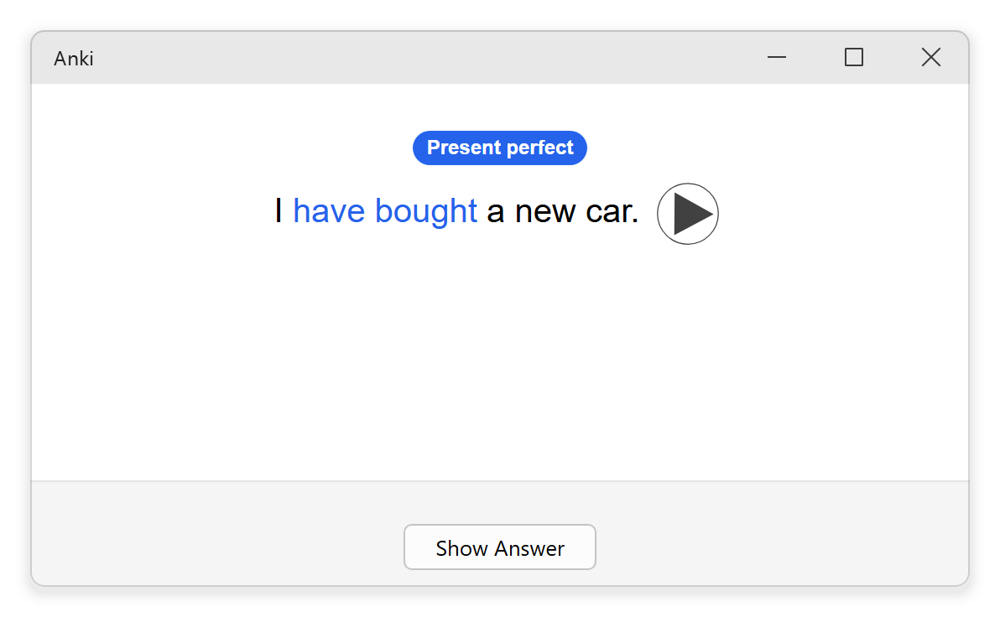
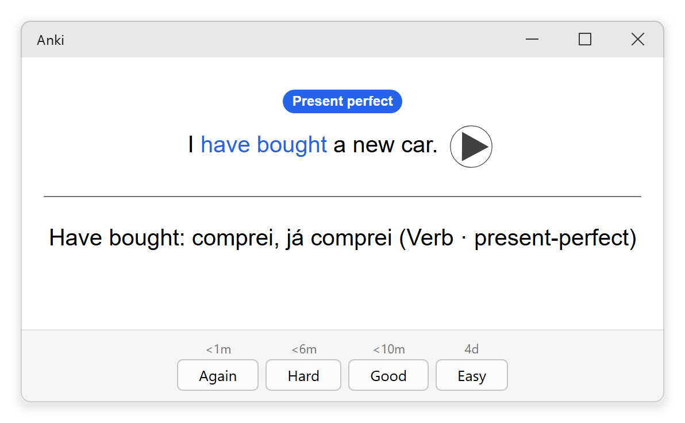
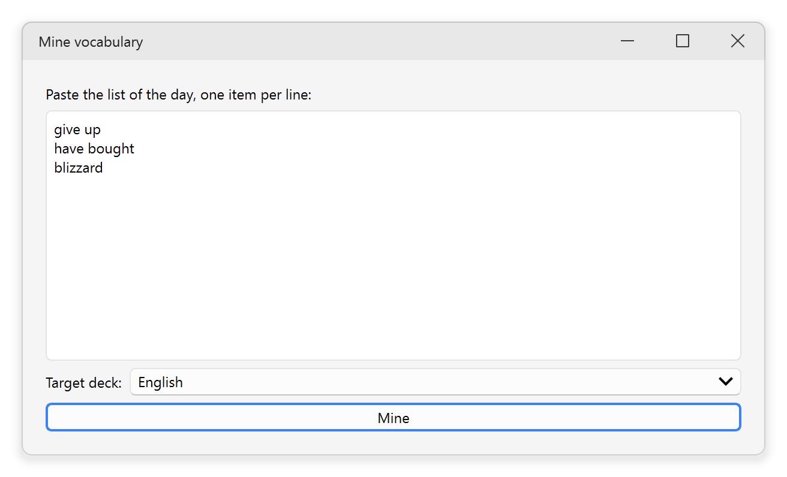
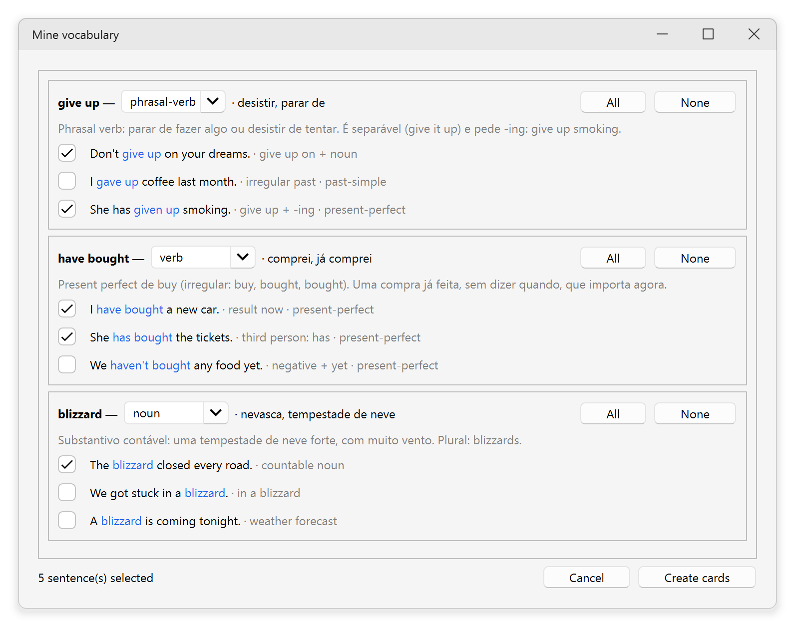
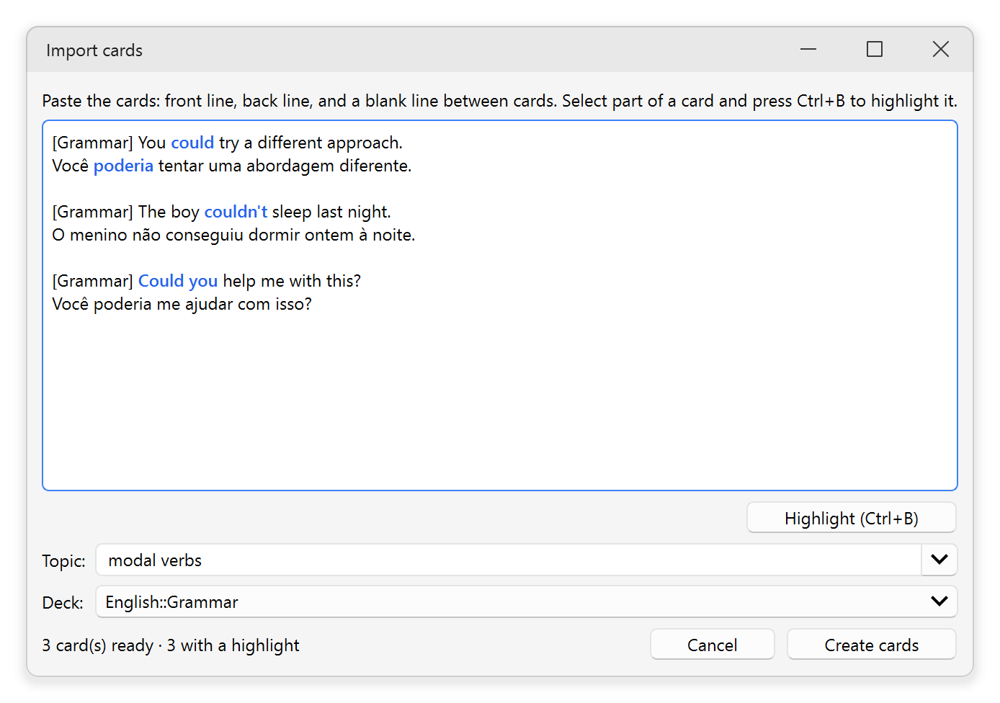
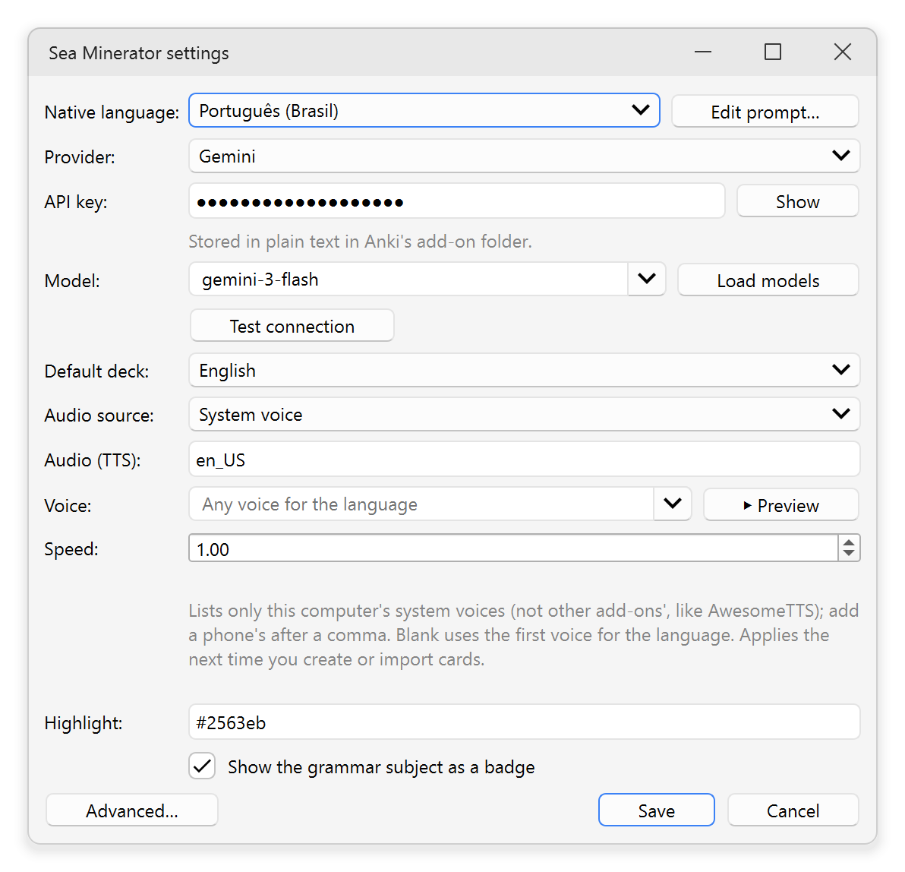

# Sea Minerator

**Turn the English words you pick up each day into Anki cards you'll remember.**

Sea Minerator is an [Anki](https://apps.ankiweb.net/) add-on. Paste your list
of new words, an AI writes short example sentences for each one, you keep the
ones you like, and each sentence becomes a card: the word highlighted,
translated the way that sentence uses it, with audio and a badge naming its
grammar.

<p align="center">
  
  
</p>

## Is it for you?

Everyone learns English their own way. Sea Minerator is built around one of
them, the one I use every day: **learn each word inside a real sentence, hear
it, and review it with spaced repetition.**

It fits you if:

- you collect new words and expressions during the day (from series, work,
  music, classes) and want them in Anki without typing every card;
- you'd rather remember *"I have bought a new car"* than *"buy, bought,
  bought"*;
- you want to hear each sentence and see its grammar (present perfect,
  phrasal verb, modal verbs…) right on the card.

It's probably not for you if you want ready-made decks, word → definition
cards, or a language other than English to learn. Explanations and
translations, though, come in your own language: 20 are available, from
Portuguese and Spanish to Japanese and Arabic.

## How it works

**1. Paste your list of the day.** In Anki, open `Tools → Mine vocabulary…`,
type one word or expression per line, choose a deck and click **Mine**.

<p align="center">
  
</p>

**2. Keep the sentences you like.** For each word you get a short explanation
in your language, its translations, its class and example sentences. Check
the ones that should become cards.

<p align="center">
  
</p>

**3. Study.** Click **Create cards**. Each checked sentence is one card:

- **Front:** the sentence, with the word in color, and its audio. A badge
  names the grammar subject (`Present perfect`, `Modal verbs`…); a
  vocabulary-only sentence has none.
- **Back:** the word as the sentence uses it, its translation *in that
  sentence* (same person and tense), its class and its grammar topic.

The whole batch is one undo step (`Edit → Undo`).

### Already have your sentences?

Got them from a class, a book or a teacher? `Tools → Import cards…` turns them
into the same kind of card, without the AI. Paste a front line and a back
line for each card, select a part and press **Ctrl+B** to highlight it, and
pick the grammar topic: it becomes the badge.

<p align="center">
  
</p>

## Install

Sea Minerator needs Anki 25.07 or later for desktop (Windows, macOS or
Linux). The cards it creates also work in AnkiDroid and AnkiMobile.

Download `sea-minerator.ankiaddon` from the
[latest release](https://github.com/luks-santos/anki-sea-minerator/releases/latest).
In Anki, open `Tools → Add-ons → Install from file…`, pick the file, and
restart Anki. Sea Minerator will also be on AnkiWeb soon.

## Set up

Open `Tools → Sea Minerator settings…`:

1. Choose your native language.
2. Choose an AI provider and paste its key:
   - **Gemini**: the easiest start, with a free key from
     [Google AI Studio](https://aistudio.google.com/);
   - **OpenAI** or a compatible service (OpenRouter, Groq…);
   - **Anthropic** (Claude);
   - **Local**: a model running on your computer with
     [Ollama](https://ollama.com/) or LM Studio, no key needed.
3. Click **Load models**, pick one, **Test connection**, then **Save**.

<p align="center">
  
</p>

By default the cards speak with your computer's own voice. For a recording
that sounds the same on every device, set **Audio source** to Google
Translate (free, unofficial) or Gemini.

**Privacy:** the add-on has no server of its own. Your list of words goes to
the AI provider you chose, with the grammar topics already in your
collection, so new cards reuse them. If you chose a recorded audio source,
the sentences go to that service (Gemini falls back to Google Translate).
Your key is stored in plain text in Anki's add-on folder on your computer.

## Learn more

- [User guide](docs/guide.md): what goes on each card and how to search for
  it, importing rules, every setting, and audio in depth.
- [Development](docs/development.md): run the add-on straight from this
  repository and run the tests.

## Building from source

The add-on's only runtime dependency, `httpx`, is vendored into
`src/seaminerator/_vendor/` with its own dependencies, because an
`.ankiaddon` has no install step. Only pure-Python packages belong there,
since the add-on ships as one zip for every platform.

```bash
bash scripts/vendor.sh   # (re)populate src/seaminerator/_vendor/
bash scripts/build.sh    # produce dist/sea-minerator.ankiaddon
```

For development:

```bash
pip install -e ".[dev]"
pytest -q
ruff check .
ruff format --check .
mypy src
```

## License

MIT, see [LICENSE](LICENSE).
